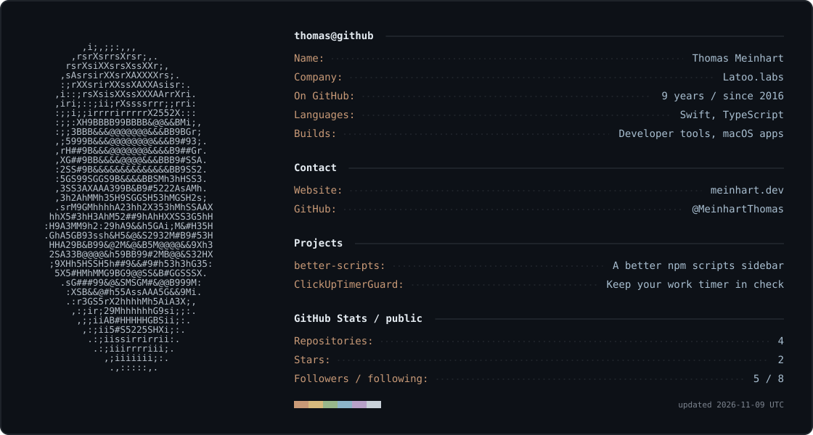

  

  <a href="https://meinhart.dev">meinhart.dev</a> &nbsp;·&nbsp;
  <a href="https://github.com/MeinhartThomas/better-scripts">better-scripts</a> &nbsp;·&nbsp;
  <a href="https://github.com/MeinhartThomas/ClickUpTimerGuard">ClickUpTimerGuard</a>

Text version

**Thomas Meinhart** · Latoo.labs · [meinhart.dev](https://meinhart.dev)

Building developer tools and macOS apps with TypeScript and Swift.

- [better-scripts](https://github.com/MeinhartThomas/better-scripts) — a richer npm scripts sidebar for VS Code.
- [ClickUpTimerGuard](https://github.com/MeinhartThomas/ClickUpTimerGuard) — a macOS menu bar app that reminds you when your ClickUp timer isn't running.

The card's public GitHub statistics refresh daily using GitHub Actions.

